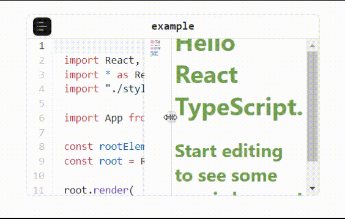

个人仓库，代码随时更新，请按发布版本查看，直接拉大部分情况报错

[English](./README.md) | 简体中文

# Playground

#### 在浏览器中运行 JS 代码

几乎所有的代码 Playground 都依赖服务端打包，因此我写了一个在浏览器本地完成打包的代码 Playground。

> [!NOTE]
> 当前处于测试阶段，请勿用于生产环境。  
> 欢迎在 `tag:0.1.0` 之后使用，并提交 Issues。



## 下一步计划

- [ ] 减小包体积：禁用 Tailwind CSS
- [ ] 功能实现：Vue（目前仅支持 React）、自定义加载、依赖版本确定、本地依赖注入（目前通过 unpkg 获取依赖）、CSS 注入、开放 esbuild 插件
- [ ] 支持 Monaco Editor（更好的 TypeScript 类型提示）和 Shiki（更小体积、更快速度）
- [ ] 测试覆盖率
- [ ] 兼容 Next、CJS 等

## Playground Client

这是上层核心包。与框架无关，负责后端相关功能。

## Playground React

提供可在浏览器中运行的可编辑 Playground 的 React 组件。

```shell
npm i @xqcc/playground-react
```

```jsx
import { Playground } from "@xqcc/playground-react";
import "@xqcc/playground-react/style.css";

<Playground template="react" name="your want name" />;
```
